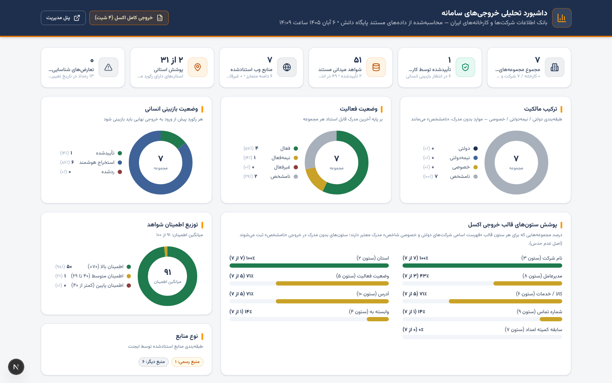
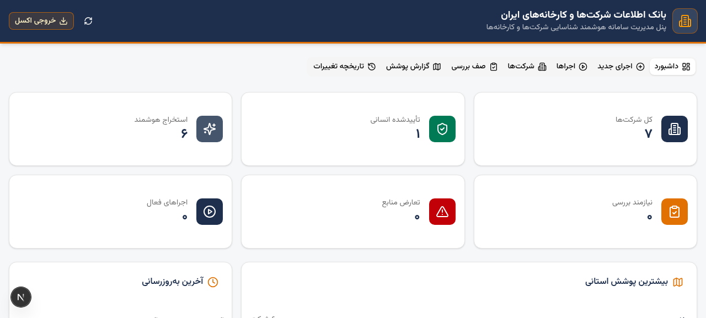
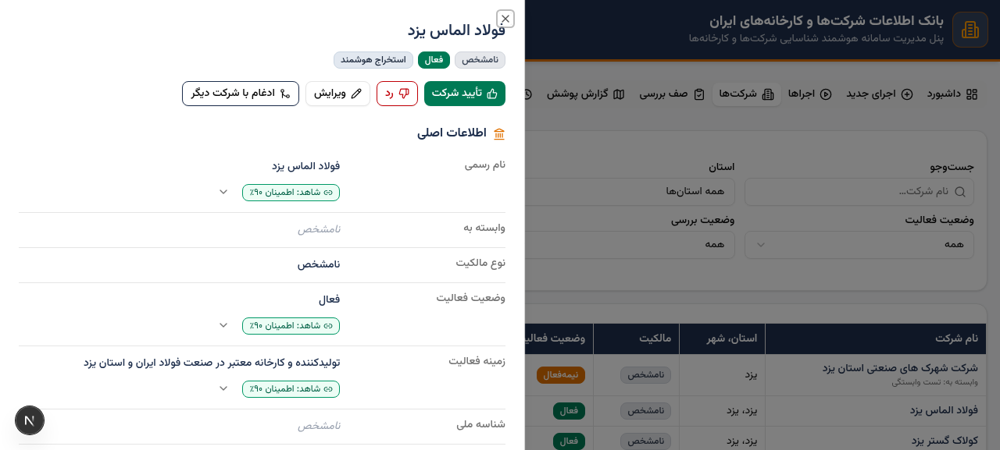

# بانک اطلاعات شرکت‌ها و کارخانه‌های ایران

سامانه هوشمند شناسایی، استخراج و مدیریت اطلاعات شرکت‌های دولتی، نیمه‌دولتی و خصوصی و کارخانه‌های ایران به تفکیک استان و شهر — با استناد به منابع عمومی وب، ثبت شواهد مستند برای هر فیلد و تولید خروجی اکسل مطابق قالب رسمی «فهرست اسامی شرکت‌های دولتی و خصوصی شاخص».

> **اصل بنیادین سامانه: عدم حدس.** هر فیلد بدون مدرک معتبر، صریحاً «نامشخص» ثبت می‌شود. هر مقدار مستخرج باید دارای منبع (URL)، نقل‌قول مستقیم، تاریخ دسترسی و نمره اطمینان باشد.

## امکانات کلیدی

- **ایجنت هوشمند کشف (۴ مرحله‌ای):** برنامه‌ریزی کوئری‌ها ← کشف مجموعه‌های نامزد از جست‌وجوی وب ← پژوهش عمیق هر نامزد با استناد ← پایان با آمار کامل؛ همراه با نقاط بازرسی (Checkpoint) برای ادامه از محل توقف و سقف بودجه درخواست.
- **مدل داده مستندمحور:** هر فیلد استخراجی یک رکورد «شاهد میدانی» با منبع، نقل‌قول، تاریخ مؤثر و اطمینان ۰ تا ۱۰۰ دارد؛ تعارض‌ها به‌طور خودکار شناسایی و به صف بازبینی انسانی می‌روند.
- **پنل مدیریت فارسی (RTL):** ۷ بخش — داشبورد، اجرای جدید، اجراها، شرکت‌ها، صف بازبینی (۴ زیرصف)، گزارش پوشش ۳۱ استان و تاریخ تغییرات؛ به‌همراه ویرایش اجباری با ذکر دلیل، تأیید/رد شواهد و ادغام رکوردهای تکراری.
- **داشبورد تحلیلی (`/dashboard`):** نمای زنده خروجی‌ها — KPI، توزیع مالکیت/فعالیت/بازبینی، پوشش تک‌تک ستون‌های قالب اکسل، توزیع اطمینان شواهد، توزیع جغرافیایی و دامنه‌های پراستناد.
- **خروجی اکسل ۴ شیت** (ExcelJS) دقیقاً مطابق قالب: ساختار RTL، سربرگ‌های ادغام‌شده چندسطحی، فونت B Mitra و ستون «نامشخص» برای داده‌های فاقد مدرک.

| داشبورد تحلیلی | پنل مدیریت | شواهد رکورد |
| --- | --- | --- |
|  |  |  |

## پیش‌نیازها

| ابزار | نسخه | توضیح |
| --- | --- | --- |
| Node.js | 20.9 یا بالاتر (پیشنهاد: LTS 22) | برای اجرای Next.js و Prisma |
| Git | آخرین نسخه | برای دریافت مخزن |
| npm | همراه Node.js | مدیریت بسته‌ها |

## نصب سریع روی ویندوز (PowerShell)

```powershell
git clone https://github.com/sjalilvand/compone.git
cd compone
powershell -ExecutionPolicy Bypass -File .\setup.ps1
npm run dev:win
```

سپس در مرورگر: `http://localhost:3000` (پنل مدیریت) و `http://localhost:3000/dashboard` (داشبورد تحلیلی)

## نصب دستی (ویندوز / لینوکس / مک)

```bash
git clone https://github.com/sjalilvand/compone.git
cd compone
npm install
```

فایل `.env` در ریشه پروژه بسازید:

```
DATABASE_URL=file:../db/custom.db
```

سپس:

```bash
npx prisma generate
npm run dev:win    # ویندوز
npm run dev        # لینوکس / مک
```

> **داده نمونه:** فایل `db/custom.db` شامل نتایج اجرای آزمایشی واقعی (۷ مجموعه در استان‌های یزد و البرز به‌همراه شواهد و منابع) است؛ بنابراین پس از نصب، داشبورد و پنل بلافاصله داده دارند. برای شروع از صفر، فایل دیتابیس را حذف و دستور `npx prisma db push` را اجرا کنید.

> **قابلیت جست‌وجوی وب ایجنت** از طریق `z-ai-web-dev-sdk` کار می‌کند و نیازمند اعتبارنامه پیکربندی‌شده سرویس Z.ai در محیط اجراست. بدون آن، سایر بخش‌ها (پنل، داشبورد، خروجی اکسل) کاملاً کار می‌کنند؛ فقط اجراهای کشف جدید نتیجه‌ای برنمی‌گردانند و خطا در لاگ اجرا ثبت می‌شود.

## اجرای یک کشف جدید

1. در پنل مدیریت، تب «اجرای جدید» — استان/شهرها و انواع مجموعه (دولتی، نیمه‌دولتی، خصوصی، کارخانه، خدماتی‌بازرگانی) را انتخاب کنید.
2. سقف درخواست‌ها را تعیین و اجرا را شروع کنید؛ پیشرفت مرحله‌به‌مرحله در تب «اجراها» نمایش داده می‌شود.
3. پس از پایان، رکوردها در صف بازبینی بررسی و تأیید می‌شوند و از دکمه «خروجی اکسل» فایل قالب‌مند دانلود می‌شود.

## ساختار پروژه

```
├─ prisma/schema.prisma        # مدل داده: Company, Location, Contact, Officer,
│                              #   CooperationRecord, Source, FieldEvidence, CrawlJob, AuditLog
├─ db/custom.db                # دیتابیس SQLite (شامل داده نمونه)
├─ src/app/page.tsx            # پنل مدیریت (۷ تب)
├─ src/app/dashboard/          # داشبورد تحلیلی زنده
├─ src/components/admin/       # اجزای پنل مدیریت
├─ src/components/dashboard/   # اجزای نموداری داشبورد (SVG بدون وابستگی کلاینت)
├─ src/lib/agent/              # موتور ایجنت ۴ مرحله‌ای + پرامپت‌ها + لایه SDK
├─ src/lib/excel/export.ts     # تولید خروجی اکسل ۴ شیت مطابق قالب
├─ src/lib/regions.ts          # ۳۱ استان و شهرهای ایران
├─ src/lib/normalize.ts        # نرمال‌سازی فارسی، تلفن، نام؛ محافظت فرمول‌نویسی اکسل
└─ src/app/api/                # REST API (stats, jobs, companies, queues, coverage, audit, export, ...)
```

## API اصلی

| مسیر | کارکرد |
| --- | --- |
| `GET /api/stats` | آمار کلی (تعداد، وضعیت بازبینی، استان‌های برتر) |
| `GET/POST /api/jobs` | فهرست و ایجاد اجرای کشف |
| `POST /api/jobs/[id]/start` · `/pause` · `/resume` · `/stop` | کنترل چرخه اجرا |
| `GET /api/companies` | جست‌وجو و فیلتر رکوردها |
| `GET /api/queues` | صف‌های بازبینی (تعارض، اطمینان پایین، تکراری، ناقص) |
| `GET /api/coverage` | گزارش پوشش استانی |
| `GET /api/audit` | تاریخ تغییرات |
| `GET /api/export?scope=all` | خروجی اکسل ۴ شیت (`scope=province&province=یزد` برای خروجی استانی) |
| `GET /api/regions` | درخت استان/شهر برای فرم اجرا |

## اصول کیفیت داده

- هر مقدار مستخرج با **منبع + نقل‌قول + تاریخ دسترسی + اطمینان** ذخیره می‌شود.
- مقادیر مورد تردید یا متعارض به‌جای انتشار، به **صف بازبینی انسانی** می‌روند.
- ویرایش انسانی فقط با **ذکر دلیل** مجاز است و در **تاریخ تغییرات** ثبت می‌گردد.
- در خروجی اکسل، هر سلول بدون مدرک معتبر عیناً «نامشخص» درج می‌شود.
